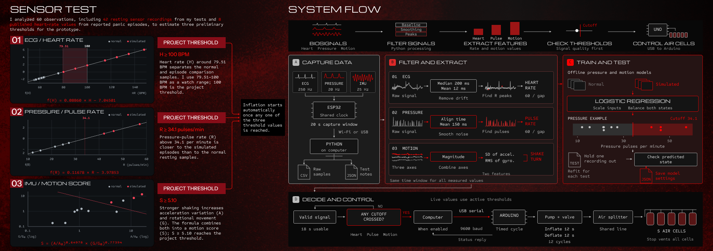

# Wearable Biosignal Pipeline

ECG, film-pressure and IMU acquisition, signal processing, exploratory model
training, and a computer-to-Arduino air-cell bench controller. This repository
collects the runnable software behind **Frame 5 — Sensor Test / System Flow**.

[中文使用说明](README.zh-CN.md) · [Frame 5 code map](docs/FRAME5.md) ·
[Algorithms](docs/ALGORITHMS.md) · [Hardware and protocols](docs/HARDWARE.md)



## Run without hardware

Use Python 3.12. From this repository folder on macOS or Linux:

```bash
python3 -m venv .venv
source .venv/bin/activate
python -m pip install -r requirements.txt
python tools/reproduce_frame5.py
python tools/demo_pipeline.py
python tools/run_checks.py
```

The first command reproduces the fitted coefficients and capture-level
leave-one-out results. The second runs a synthetic 20-second three-sensor
recording through the existing feature and decision code. Neither command
connects to devices or sends pump/valve commands.

Results are saved in `models/frame5_models.json`,
`reports/frame5_reproduced.json`, and `reports/synthetic_demo.json`.
The original exported coefficients are preserved independently in
`models/reference_frame5.json` for regression checks.

## Open the original test interface

```bash
python launch_jupyter.py
```

Open `00_多传感器原型演示.ipynb`, select **Python 3 (ipykernel)**, and run the
launch cell with **Shift+Enter**. The original English capture controls and
plots are retained. Simulation is the default. Firmware and physical wiring
are described in [Hardware](docs/HARDWARE.md).

For historical waveforms, import your local CSV/JSON pairs and then run
`06_历史波形回看.ipynb`:

```bash
python tools/import_recordings.py /path/to/original/data/runs
python tools/extract_features.py
```

The waveform files stay in Git-ignored `data/runs/`. The included
capture-level feature table is sufficient to reproduce the offline models.
See [Data and evaluation](docs/DATA.md) for the distinction.

## What Frame 5 corresponds to

| Panel | Implementation |
|---|---|
| A — Capture data | ESP32 `08_sensor_sync`, `wifi_transport.py`, `lab_suite.py`, `combined_panel.py` |
| B — Filter and extract | `ecg_analysis.py`, `candidate_rules.pressure_rate`, IMU magnitude features |
| C — Train and test | `modeling.py`, `frame5_analysis.py`, `tools/reproduce_frame5.py` |
| D — Decide and control | Existing `candidate_rules.py`, `airbag_bridge.py`, Uno `09_airbag_command_bench` |

**Two parameter versions are intentionally identified.** Frame 5 displays
the offline rest-only pressure cutoff **34.0682** and motion score
**S ≥ 5.1035**. The existing live candidate code still uses pressure
**34.7853** and a different motion formula **Q ≥ 9.1508**. The offline
rest-only model is not silently substituted into the actuator path.
See the [exact formulas and version differences](docs/ALGORITHMS.md).

The fitted ECG comparison crosses zero at **79.5149 BPM**; the displayed
project reference remains **100 BPM**. The comparison mixes local normal HR
estimates with published episode maxima and is not a validated clinical model.

## Data and verification

The feature table has 53 local captures: 52 yield usable features, including
42 usable rest-context records. Eight published HR values bring the overall
analysis count to 60 usable observations. Rest-only fitting uses 11 pressure,
11 IMU and 20 usable ECG records plus the 8 published values.

The two local labels mean **normal tasks** and **self-simulated actions**;
`SIMULATED` in the acquisition software separately means software-generated
signals. These meanings must not be merged.

The initial repository verification ran 41 tests: **40 passed and 1 optional
private-waveform test was skipped**. Model coefficients and held-out results
match the original analysis. Tests use synthetic signals, virtual serial/HTTP
devices and saved analysis results. No real hardware validation was performed
as part of packaging. Detailed results are in `reports/test_results.json`.

The Uno V5 code uses 12 seconds of inflation and 12 seconds of deflation,
repeated 12 times. Its output path is for the existing nonhuman bench setup;
it has no air-cell pressure or breathing-phase feedback. A complete 12-round
V5 physical sequence has not been verified. ESP32 sampling and Python
processing still require a running computer.

## Repository guide

```text
00_多传感器原型演示.ipynb    Original capture dashboard
02_... through 05_...     Individual module notebooks
06_历史波形回看.ipynb       Local recording replay
ecg_analysis.py          Baseline removal, noise-aware peaks and HR estimation
candidate_rules.py       Pressure/IMU features and active candidate thresholds
combined_panel.py        Three-channel acquisition and optional bench handoff
airbag_bridge.py         Identified, bounded USB serial command sequence
frame5_analysis.py       Portable rest-only model reproduction
modeling.py              Class-balanced L2 logistic regression
arduino/                 ESP32 acquisition and independent Uno firmware
vendor/libraries/        IMU dependencies with upstream licenses
data/features/           Deidentified capture-level inputs
data/external/           Cited published HR observations
models/                  Reference and reproduced model parameters
tools/                   Reproduction, demo, extraction, import and checks
tests/                   Software regression tests
docs/                    Algorithms, wiring, provenance and GitHub guide
```

## Publication and third-party material

This package is prepared for an initial **private** GitHub repository. No
automatic command makes it public. Raw waveforms, notebook execution output,
Jupyter login tokens and local runtime folders are excluded from publication.

Project license selection is left to the author. DFRobot library licenses are
retained in `vendor/libraries/`. The external paper is cited and linked; its
PDF is not redistributed. See [Sources](docs/SOURCES.md).
